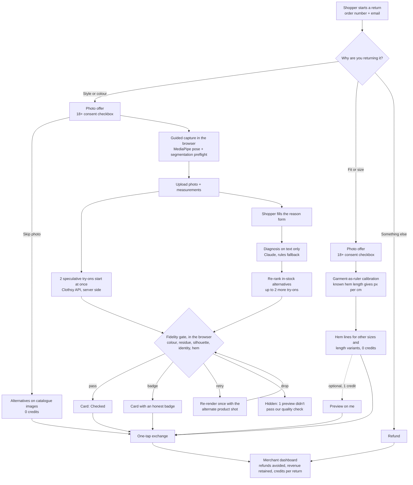
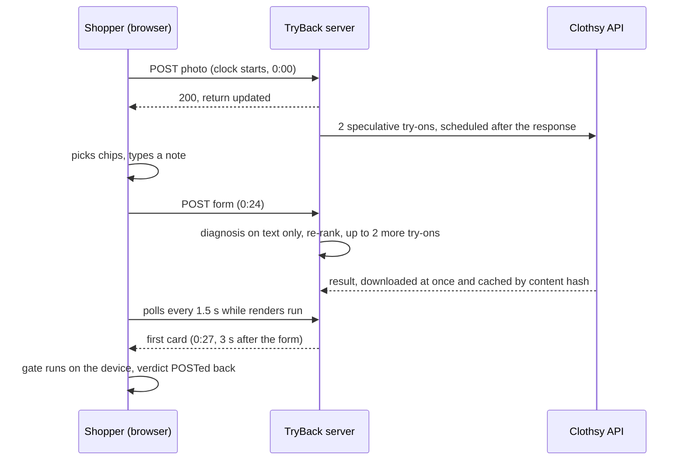

# TryBack

**Virtual try-on on the returns page, not the product page.**

Every virtual try-on today lives on the product page and helps sell the item. TryBack runs at the other end of the funnel. When a shopper returns something because the style or colour didn't work, they take one photo **wearing the item they're sending back**. While they fill in the return form, TryBack renders in-stock alternatives on that photo with the Clothsy AI try-on API (by FabricVTON). Each render passes a fidelity gate before the shopper sees it, and the refund becomes a one-tap exchange.

Size returns don't need AI at all. The returned garment's known length works as a ruler on the photo, so TryBack draws where the hem would fall in other sizes and length variants, at zero credits.

> **Try-on before purchase sells. TryBack keeps the sale.**

Built for **HackTheFashion Global'26**, track **Try-On Commerce**.
Demo brand: **Fernweave**, a fictional DTC label we invented for this project. Its catalogue, size charts, customers and orders are all made up.

- Demo video: [link] (filmed by `npm run record`; see [Demo video](#demo-video))
- Live demo: [URL] (see [Testing access for judges](#testing-access-for-judges))
- Devpost: [link] · draft in [`docs/DEVPOST.md`](docs/DEVPOST.md)
- Going live, step by step: [Going live checklist](#going-live-checklist)
- Deployment: [`docs/DEPLOY.md`](docs/DEPLOY.md) · gate tuning: [`docs/GATE-TUNING.md`](docs/GATE-TUNING.md) · Clothsy API behaviours and evidence: [`docs/CLOTHSY-NOTES.md`](docs/CLOTHSY-NOTES.md) · video beats: [`docs/DEMO-SCRIPT.md`](docs/DEMO-SCRIPT.md)

---

## How it works



The style/colour path hides render latency behind the form the shopper has to fill in anyway (the timings below are an example):



## Features

**Guided capture with pose preflight.** MediaPipe Pose Landmarker and the selfie multiclass segmenter run in the browser (WASM, served from `/public`). A live coach at about 4 fps guides framing, and a 3-second timer takes the shot. Before upload, a checklist covers full body, a single person, a frontal pose, the garment visible, the torso unobstructed, lighting and sharpness, with a fix prompt for each failure. Photos are EXIF-corrected, un-mirrored and normalised to 1600 px or less before they leave the device.

**Speculative rendering behind the form, with an honest clock.** Two renders start the moment the photo lands: one silhouette change and one colour change, both in stock in the shopper's size. The shopper fills in the reason form while they run. After the form, the diagnosis re-ranks candidates, already-rendered ones are kept if they still rank, and up to two more renders are scheduled. The results screen states exactly what happened, e.g. *"Renders started at photo upload · form done 0:24 · first card 0:27 (3 s after form)"*. We don't pretend renders are instant.

**Source-aware fidelity gate.** TryBack knows what the shopper is wearing (the SKU being returned) and what each render should show (the target SKU), so it can check the result instead of trusting it. The gate runs on the device and measures:

| Metric | What it catches |
|---|---|
| Colour ΔE (CIEDE2000) vs the target colour, lighting-corrected from the worn garment | wrong colour |
| Residue: share of garment pixels still matching the returned garment's colour | the old garment leaking through |
| Silhouette IoU vs the original garment mask | "new" dress that kept the old shape |
| Identity drift in the face region | a different-looking person |
| Hem error in cm (needs calibration) | wrong length |
| Garment coverage of the torso | garment missing |

Which checks apply depends on the transition type (`colour_only`, `like_silhouette`, `shorter`, `longer`, `slim_to_loose`, `loose_to_slim`). Silhouette leakage only counts when the shape should change, and residue only when the colour should. The verdict is **pass** (Checked), **badge** (shown with an honest note such as "Colour preview · silhouette approximate"), **retry** (re-render once with the alternate product shot) or **drop** (hidden behind "1 preview didn't pass our quality check"). Badges never comment on the shopper's body or skin. The thresholds live in `lib/cv/thresholds.json`; `npm run tune` recalibrates them on real renders through the same browser code ([`docs/GATE-TUNING.md`](docs/GATE-TUNING.md)).

**Garment-as-ruler size lines at zero credits.** Try-on can't show size, so we don't fake it. The returned garment's high-point-shoulder-to-hem length for the purchased size is known, so the observed hem on the photo gives pixels per centimetre. TryBack then draws a dashed hem line with a ± band for every size and length variant in the same colour, next to a solid line at "what you're wearing". It also states the grading truth, e.g. *"L adds only +1.5 cm length but +5 cm chest — sizing up won't fix 'too short'"*, and recommends the option that fixes every complaint with the fewest side effects (often a Tall or Petite variant, not a bigger size). If the garment ruler can't be used, an optional height entry at capture gives a wider-band estimate. With neither, the shopper gets a table-only view. "Preview on me" is optional and costs 1 credit.

**Merchant dashboard** (`/merchant`). Refunds turned into exchanges, revenue retained (net of the $10 exchange bonus recorded on each exchange), photo opt-in rate, credits per return and $ cost, a live "Refund avoided +$79" toast, per-SKU diagnosis bars ("Wrap Dress — Mustard: colour 41%, too clingy 38%"), gate verdict breakdown, recent returns, and a **Try-on API panel** with p50/p95 latency and gate pass rate per transition type plus time-to-first-card after the form. A toggle includes or excludes the seeded demo history, which is always labelled; its latencies are generated, so the panel marks them "illustrative, not measured" whenever they're included.

**Transition benchmark** (`/bench`). One row per transition type with count, p50/p95 latency, gate pass/badge/retry/drop counts and photo-vs-render thumbnails (each render tagged "AI" or "Sim"). "Re-run gate in browser" re-scores every render. Stats are public, but photos and renders only show for returns made in your browser, or with the `LIVE_ACCESS_CODE` unlocked. The day-1 probe (`npm run probe`) is separate: it needs `--i-have-consent`, picks SKUs whose product images are photos (and refuses drawings unless `--allow-drawings`), checks the account's credits before spending any, and writes `probe/out/*`, `probe/results.jsonl`, `probe/REPORT.md` and `probe/observed.json` from a matrix of consenting team members × SKUs. None of it appears on `/bench`.

**Also:** a split-screen `/demo` (phone frame running the shopper flow next to a compact dashboard, with "Reset demo" for your own returns), a no-photo path with alternatives on catalogue images, a "Skip to refund" link on every screen, and a "Product photo credits" link in the shopper footer.

## Quick start

Requires Node 20.9 or newer.

```bash
npm i
cp .env.example .env.local      # works with no keys: simulated try-on, rules diagnosis
npm run dev                     # http://localhost:3000, then open /demo
npm run doctor                  # readiness checklist: PASS/WARN/FAIL with a fix per line (0 credits, 0 tokens)
```

The product shots are committed in `public/catalog/`. If any go missing, `npm run assets` restores the placeholder drawings (it never overwrites photos, even with `--force`).

> **Behind a company proxy?** If `npm i` fails with `UNABLE_TO_GET_ISSUER_CERT_LOCALLY`, point npm at a CA bundle that contains your company root **and** the public roots (`npm_config_cafile` replaces npm's built-in list, so a company-only bundle breaks every other registry call):
>
> ```bash
> # macOS example: public roots + your company root in one file
> security find-certificate -a -p /System/Library/Keychains/SystemRootCertificates.keychain > ~/ca-bundle.pem
> cat /path/to/company-root.pem >> ~/ca-bundle.pem
> export npm_config_cafile=~/ca-bundle.pem
> npm i
> ```
>
> If the dev server, `npm run doctor` or `npm run probe` then fail to reach Clothsy or Anthropic the same way, prefix them with `NODE_EXTRA_CA_CERTS=/path/to/company-root.pem` (that variable adds to Node's roots instead of replacing them). The doctor suggests this when it sees a certificate error.

With no keys, every render comes from the dev double. It costs 0 credits and is labelled **"Simulated preview"** in the UI and watermarked on the image. Add `CLOTHSY_API_KEY` to `.env.local` for real renders, which are labelled **"AI-generated preview"**. Add `ANTHROPIC_API_KEY` for LLM diagnosis; without it, deterministic keyword rules handle the form text.

Demo orders: **1042**, **1043** and **1044**, with email `demo` (the order lookup has quick-fill buttons). #1042 is the style/colour return, #1043 the size return, #1044 a plain refund.

| Script | What it does |
|---|---|
| `npm run doctor [-- --json]` | Checks keys (free `GET /account`; Anthropic via the Models API, 0 tokens), credit caps against the balance, mode, catalogue, models, data dir and tools. Exit 0 = ready for live. When ready, it prints the probe command to run next (you add `--i-have-consent` yourself). |
| `npm run catalog:import` | Re-renders the photographed catalogue families from `assets-src/catalog/manifest.json` ([Product photos](#product-photos)). The committed images are already up to date. |
| `npm run probe` | Day-1 live probe: consenting adults × photographed SKUs, hard credit cap, `probe/REPORT.md` ([checklist](#going-live-checklist)). `-- --help` lists the flags. |
| `npm run tune` | Calibrates the fidelity-gate thresholds on the probe's real renders, 0 credits ([`docs/GATE-TUNING.md`](docs/GATE-TUNING.md)). |
| `npm run record` | Films the demo video ([Demo video](#demo-video)). |
| `npm run smoke -- --base <url>` | Post-deploy smoke test; aborts before spending credits. |
| `npm run purge -- --base <url> \| --local` | Retention status, sweep and pins. |
| `npm test`, `npm run typecheck`, `npm run lint`, `npm run assets -- --check` | Tests, types, lint, and a per-file photo/placeholder report for the catalogue. |

> **Camera on a phone:** browsers only allow `getUserMedia` on `https://` or `localhost`. To test on a phone, use an HTTPS deployment or tunnel; the upload fallback works everywhere.

## Going live checklist

Everything below is one command per step. Credits are only spent in steps 4 and 7 (and in step 8's pre-warm), each with a hard cap.

1. **Product images.** Done: every family has a product image ([Product photos](#product-photos)). To swap one for your own photo later: `npm run catalog:import -- --only <family> --sheet catalog-sheet.png`.
2. **Clothsy key.** Sign in with Google at <https://app.clothsyai.fabricvton.com/api-keys> → Developer API → Create API key (it starts `clothsy_live_` and is shown once). In `.env.local` set `CLOTHSY_API_KEY=clothsy_live_…` and keep `DAILY_LIVE_RENDER_CAP` at or below the credits you have (`.env.example` ships 18 for a new account's 20; lower it to 13 after the 7-credit probe in step 4, which doesn't count toward the app's cap). The doctor fails while the cap is above your balance.
3. **Check.** `npm run doctor`. Fix every FAIL line; exit 0 means ready.
4. **Probe (≤ 7 credits).** Put 3 full-body, front-facing JPEGs in `probe/people/` (gitignored, at least 600 px on the short side): consenting adults (18+, agreed to their photo being sent to the try-on API) or AI-generated people. This working copy already has three AI-generated people there (`hero.jpg`, `probe-2.jpg`, `probe-3.jpg`, all in the mustard wrap dress; all pass the photo checks), and the two video shoppers are in `probe/video/` (`hero.jpg`, `shirt.jpg`; both gitignored). Then:
   ```bash
   npm run tune -- --preflight-only --people probe/people   # 0 credits: retake any photo that fails
   npm run probe -- --dry-run                               # 0 credits: the plan (photographed SKUs) and worst-case cost
   npm run doctor                                           # prints the exact probe command, e.g.:
   npm run probe -- --people probe/people --skus <two photographed SKUs> --max-credits 7 --check-replay --i-have-consent
   ```
   The doctor prints the command **without** `--i-have-consent`: add it yourself once every person in `probe/people/` has agreed to their photo being sent to Clothsy AI, or use `--ai-people` instead when every photo shows an AI-generated person (the report records it). With the AI-generated people above: `npm run probe -- --people probe/people --skus fw-wrap-dress-emerald,fw-aline-midi-cobalt --max-credits 7 --check-replay --ai-people` (3 people × 2 SKUs = 6 renders + 1 replay check). Without `--skus` the probe picks the same photographed SKUs itself, and a live run refuses SKUs whose product image is still a drawing unless you pass `--allow-drawings`.
   Read `probe/REPORT.md` → **Recommendations**. It settles the three things the Clothsy docs don't cover: whether a replayed request is free and how it's signalled, the account response shape, and the output image size and padding (which the gate's crop assumes). Each is tracked in [`docs/CLOTHSY-NOTES.md`](docs/CLOTHSY-NOTES.md). Use three people: two photos (`--max-credits 5`) give only 4 renders, and step 5 needs at least 6 good ones to apply new thresholds.
5. **Tune the gate (0 credits).** `npm run tune` (add `--wearing <sku>:<size>` if the people aren't wearing `fw-wrap-dress-mustard` in M), read `probe/tune-report.md`, then look at every render in `probe/out/` and label each one `"good"`, `"bad"` or `"skip"` in `probe/labels.json` (start from `probe/labels.template.json`). Run it again, then `npm run tune -- --apply`: it refuses while any render is unlabelled, because one unchecked bad render would loosen the gate. Run `npm test` (it stays green whatever the new values are), keep the new `lib/cv/thresholds.json`, and restart `npm run dev` or rebuild/redeploy: the thresholds are bundled into the browser code.
6. **Optional: `ANTHROPIC_API_KEY`** in `.env.local`, then `npm run doctor` again (the key check uses 0 tokens). Without it, keyword rules handle the form text.
7. **Record the video (≤ 5 credits).** With the AI-generated shoppers: `npm run record -- --mode auto --ai-people --photo probe/video/hero.jpg --size-photo probe/video/shirt.jpg --repo-url <repo> --demo-url <url>` (labelled "AI-generated shoppers" on screen, on the cards and in the description). With real people use `--i-have-consent` instead, only once everyone filmed agreed in writing to be filmed, to the photo going to Clothsy AI, and to publication. Re-film for free with `--mode replay` and the same files, within 14 days.
8. **Deploy** to one always-on server with a persistent disk, following [`docs/DEPLOY.md`](docs/DEPLOY.md) (Fly.io, Render or any Docker host). Set `LIVE_ACCESS_CODE` and `ADMIN_TOKEN`, keep the deployment's `DAILY_LIVE_RENDER_CAP` (5 in `fly.toml`/`render.yaml`) at or below the credits you have left, run `npm run smoke -- --base <url> --admin-token <token>`, then pre-warm and pin the judges' renders (DEPLOY §8, ≤ 5 credits). Serverless hosting won't work: the data lives in local JSON files.

## Product photos

Every family has a product image, turned into each colourway (and Tall variant) by `scripts/import-catalog.ts` (background removed, scaled to the catalogue's lengths, recoloured in CIELAB). Sources and licences are in [`public/catalog/CREDITS.md`](public/catalog/CREDITS.md), also linked from the shopper footer ("Product photo credits"):

- **AI-generated product images** (made for this demo; no real product): Wrap Dress, A-line Midi and Slip Dress (each with a separate flat-lay alternate shot for the gate's retry), Ribbed Knit Top and Linen Shirt.
- **Openly licensed photos of real garments** from Wikimedia Commons: Shirt Dress and Shift Dress (museum garments, public domain in the US, NoC-US) and Trench Coat (CC BY-SA 4.0; its derivatives are CC BY-SA). Their alternate shots are the same photo mirrored and framed 7 % smaller.

To replace any family with a photo of a garment you own:

1. Photograph the garment: solid mid-tone colour, no print, front view, whole garment in frame with a margin, on a hanger against a plain white or light-grey wall or laid flat on a white sheet, in daylight, with no person in the shot.
2. Save it as `assets-src/catalog/raw/<family>/<name>.jpg` and set that family in `assets-src/catalog/manifest.json` to:
   ```json
   { "source": "photo", "primary": { "file": "raw/<family>/<name>.jpg",
     "credit": { "title": "<what it is>", "author": "<your name>", "license": "Own photo" } } }
   ```
3. `npm run catalog:import -- --only <family> --sheet catalog-sheet.png` and open `catalog-sheet.png`. One photo becomes every colourway, Tall variant and alternate shot of that family, on the same frame and scale as the others (photos and drawings of a category share one px-per-cm, so lengths compare honestly side by side). If background is left over or part of the garment is missing, add a `crop`, tune `background.tolerance`, or add `erase`/`include` polygons (source-pixel coordinates) and run it again.

Alternatively, drop finished images into `public/catalog/` under the exact existing filenames (any size or format, a 768×1024 PNG included) and set the family to `{ "source": "manual" }`. Every generated drawing carries a `TryBack: placeholder` PNG marker, so anything without it counts as a photo: the doctor and the probe treat it as one, and neither `npm run assets` (even with `--force`) nor the importer overwrites it (the importer only does so with `--force`). Afterwards, tape-measure the garment you'll wear on camera from the high point of the shoulder to the hem, and update `baseM` in `lib/catalog.ts` if it's more than about 3 cm off, so the size lines stay true. Replacing a product image changes its hash, so renders of the old image never replay.

## Modes

| Variable | Behaviour |
|---|---|
| `TRYON_MODE=auto` (default) | Live Clothsy calls when `CLOTHSY_API_KEY` is set, otherwise the dev double (simulated, 0 credits). |
| `TRYON_MODE=live` | Always call the API (when a key is set and under the daily cap). |
| `TRYON_MODE=dev` | Always use the dev double. Use it for UI work. |
| `TRYON_MODE=replay` | Cached renders only; misses fall back to the dev double. Zero credits. Use it for public links. |
| `DAILY_LIVE_RENDER_CAP` (default 40 if unset; `.env.example` 18, `fly.toml`/`render.yaml` 5) | Once reached, new renders fall back to the dev double. Keep it at or below the credits you have left; `npm run doctor` fails otherwise. |
| `MAX_RENDERS_PER_RETURN` (default 5) | Hard cap per return; gate retries count toward it. |
| `LIVE_ACCESS_CODE` | When set, only browsers that unlocked with the code (cookie `tb_live`) can trigger live renders. Everyone else is treated as replay. |
| `ALLOW_PUBLIC_LIVE` | Leave unset. See the note below. |
| `ADMIN_TOKEN` | Full demo wipe and retention admin (`Authorization: Bearer …`). Without it, "Reset demo" clears only your own returns and the admin endpoints are disabled. |
| `PHOTO_RETENTION_HOURS`, `RENDER_RETENTION_DAYS` | Default and maximum 24 h and 14 days, as the consent copy promises. They can only be shortened. |
| `CREDIT_USD` (default 0.08) | Price per credit for the dashboard's cost figures. **0.08 is a placeholder**; set what you actually pay. |
| `DEV_RENDER_LATENCY_MS`, `DEV_FAIL_RATE` | Dev double timing and failure injection, to exercise loading and error states. |
| `ANTHROPIC_API_KEY`, `DIAGNOSIS_MODEL` | Optional LLM diagnosis (default `claude-opus-5-5`); rules otherwise. |
| `TRYBACK_DATA_DIR` (default `.data`) | Where the JSON store, photos and render cache live. |
| `ENABLE_GATE_LAB` | Leave unset on public servers. `1` serves the dev-only `/dev/gate-lab` (used by `npm run tune`) on a production server. |
| `CLIENT_IP_HEADER` | Which header identifies a client for rate limits. Unset: `Fly-Client-IP` on Fly, `True-Client-IP` on Render, else the last `X-Forwarded-For` hop ([`docs/DEPLOY.md`](docs/DEPLOY.md) §11). |

**Production fail-safe.** On a production server (`npm start` or Docker), a Clothsy key without `LIVE_ACCESS_CODE` gives everyone replay mode unless `ALLOW_PUBLIC_LIVE=1`, so a public URL can't drain credits. The boot log says so. `npm run dev` is unaffected.

The landing page shows a mode pill ("Live · Clothsy try-on", "Replay mode" or "Demo mode"), and `GET /api/status` reports which provider a new render would use right now. A browser that hasn't unlocked a `LIVE_ACCESS_CODE` deployment sees "Replay mode", because that's how the server treats it.

## Credit budget plan

How credits work on the Clothsy API: 1 credit per *finished* try-on. Failed and never-started try-ons are refunded, image uploads are free, and a reused `Idempotency-Key` never charges twice (the probe's `--check-replay` measures this on your account). New accounts get 20 free credits.

What TryBack does to protect them:

- **Content-addressed render cache.** The key is the hash of the person photo × SKU × garment shot (the product image's bytes) × pipeline version, so re-running the same photo and SKU replays from disk at 0 credits, and replacing a product image never replays renders of the old one.
- **Idempotency key per render** (`tb_<cacheKey>`), so a retried request after a timeout can't double-charge. Only a refunded failure (the try-on ended `failed`, or a 4xx rejection) moves that render to a fresh key (`_r1`, `_r2`…); after a timeout or a failed download the same key is reused, so a try-on that finished anyway replays for free. The exception is a replay whose 24-hour result URL has already expired: that key can never produce an image again, so the render moves to a fresh key (1 credit). (Such a replay isn't counted as a spent credit on the dashboard, so the count can be 1 low after a local timeout.)
- **Hard caps.** `MAX_RENDERS_PER_RETURN` (5) per return and `DAILY_LIVE_RENDER_CAP` per day (18 in `.env.example`, 5 on the deployment configs; the doctor fails while it's above your balance); past either cap the app falls back to the labelled dev double. The probe has its own `--max-credits` and checks the account's balance before it uploads anything.
- **Zero-credit paths.** The size path, the no-photo path, replay mode, the gate tuner and every `--mode replay` video take cost nothing.
- **Rate limits respected.** Process-wide sliding-window limiters allow at most 10 try-on starts, 25 uploads and 50 status polls in any 60 s (the account limits are 12, 30 and 60), and retries follow the documented backoff, bounded by the 150 s render budget.

Plan for the 20 free credits (scale it if you have more):

| Phase | Budget | Enforced by |
|---|---|---|
| Day-1 probe: 3 consenting adults × 2 photographed SKUs + 1 replay check | ≤ 7 | `npm run probe -- --i-have-consent --max-credits 7 --check-replay` (it picks photographed SKUs; default cap 4; run `--dry-run` first) |
| Hero video take, style/colour path | ≤ 5 | `MAX_RENDERS_PER_RETURN=5` (2 speculative + ≤ 2 post-form + ≤ 1 gate retry); the size path is 0 |
| Judges' pre-warm on the deployment (DEPLOY §8) | ≤ 5 | same per-return cap; then pin the renders |
| Reserve: a retake, "Preview on me", or a gate retry | 3 | `DAILY_LIVE_RENDER_CAP` (5 on the deployment; lower it after the pre-warm) |
| Re-filming, judges' public link | 0 | `--mode replay`, `TRYON_MODE=replay`, or code-gated live under the daily cap |

Re-using the *same* photo file replays from cache at 0 credits. In another browser that only works if the file is a JPEG of at most 1600 px without EXIF/XMP metadata, which is uploaded byte-for-byte; other files are re-encoded by the browser, so they replay in the same browser engine only.

## Privacy and consent

- **Adults only, consent before capture.** The camera and upload stay locked until the shopper confirms: *"I'm 18 or older, I'm the person in the photo, and TryBack may send it to its try-on provider (Clothsy AI) to create previews. TryBack deletes its copy within 24 hours of upload and the previews within 14 days; Clothsy deletes uploads within 35 days."* The server rejects photos without this attestation and stores the consent timestamp.
- **Retention, as it really works.** An hourly sweep, started when the server boots, deletes shopper photos within 24 hours of upload (each sweep takes whatever would pass the limit before the next one, so between 23 and 24 hours) and clears the return's photo reference (that return's cards fall back to catalogue images). It deletes cached renders within 14 days, with their index entries. Renders of a consenting team member's photo can be pinned for the judges' replay (`npm run purge -- --base <url> --pin <returnId>`); unpin them after judging. Hosting snapshots and backups can hold copies until they expire ([`docs/DEPLOY.md`](docs/DEPLOY.md)). Values measured from the photo (pose keypoints, garment colour) stay on the return.
- **Skippable.** "Skip photo" and "Skip to refund" are always available, and the no-photo path still shows alternatives.
- **On-device vision.** Pose, segmentation, preflight, size lines and the fidelity gate all run in the browser. MediaPipe models are served from this app, not a third party.
- **The photo is never sent to an LLM.** Diagnosis gets text only: the chips the shopper picked, their note (with emails and phone numbers redacted), product attributes, and two numbers measured from the photo (ease ratio and hem length).
- **The try-on API is the only third party that sees the photo.** It is called server-side with `consent: true`, and results are downloaded and stored locally straight away (Clothsy result URLs expire after 24 h). Clothsy deletes uploaded photos automatically within 35 days (docs: Uploading images).
- **No judgements about skin tone or bodies**, in UI copy, LLM prompts, diagnosis or gate badges. Return chips describe the garment ("Too clingy", "Colour isn't me"), never the person.
- **Every image is labelled.** Real renders say "AI-generated preview"; dev-double renders say "Simulated preview".
- **Who sees which photo.** A return's photo and renders are reachable only through its unguessable return id. `/bench` shows them to the browser that created the return (cookie `tb_viewer`) and to browsers that unlocked `LIVE_ACCESS_CODE`; everyone else sees stats only. The public dashboard lists recent returns under opaque ids.
- **Never commit or ship photos of people.** Local data (`.data/`), probe photos and outputs (`probe/people/`, `probe/out/`, reports) and `out/` are gitignored, excluded from the Docker build context and kept out of the standalone server build.

## Testing access for judges

The public link is safe to share: it can't spend credits unless you unlock it, and a visitor never sees another visitor's photo or renders (`/bench` shows each browser only its own; the team sees all after unlocking the access code, so set `LIVE_ACCESS_CODE` even on a replay deployment if you want that view). "Reset demo" on `/demo` clears only the returns your own browser created.

**Option A, zero credits (recommended default): `TRYON_MODE=replay`.** Renders cached during our runs replay for the same photo; anything new falls back to the dev double, clearly labelled "Simulated preview". [Optional: with their permission, we provide a photo of a team member at [link]. Upload it on the capture step and follow the exact path below to see the cached live renders. It is a JPEG of at most 1600 px with metadata stripped, so it's uploaded byte-for-byte and hits the cache from any browser.]

**Option B, live renders for judges only: `TRYON_MODE=auto` + `CLOTHSY_API_KEY` + `LIVE_ACCESS_CODE`.** Visitors without the code get replay behaviour. To unlock live renders in your browser, open the landing page, click **"Have a judge access code? Unlock live try-on"** under the hero buttons and enter the code; the mode pill switches to "Live · Clothsy try-on". The same thing from the developer console:

```js
await fetch("/api/live", {
  method: "POST",
  headers: { "content-type": "application/json" },
  body: JSON.stringify({ code: "[access code from our Devpost testing instructions]" }),
}).then((r) => r.json()); // → { ok: true }
```

The cookie lasts 7 days; `fetch("/api/live", { method: "DELETE" })` locks it again. Live renders stay bounded by `MAX_RENDERS_PER_RETURN` and `DAILY_LIVE_RENDER_CAP`.

**Cached renders for judges** come from a pre-warm run with the exact click path the judges follow: order **1042** → *Wrap Dress — Mustard* → **Style or colour didn't work** → the team member's photo → chips **Colour isn't me** + **Too clingy** → empty note. Those renders are pinned so retention keeps them through judging ([`docs/DEPLOY.md`](docs/DEPLOY.md) §8). The post-form ranking also uses numbers measured in the judge's browser, so occasionally one card shows a labelled "Simulated preview" instead.

**A 3-minute walkthrough**

1. Open `/demo`: the shopper's phone is on the left and the merchant dashboard on the right.
2. In the phone: start a return, tap the **1042** quick-fill (email `demo`), pick *Wrap Dress — Mustard*, then **Style or colour didn't work**. Tick the consent box, take or upload a full-body photo, pick a couple of chips, and watch the cards arrive. Tap **Swap for this**; the dashboard shows the refund avoided.
3. Size path: order **1043**, *Linen Shirt — White*, **Fit or size**, then *Too short*. The hem lines appear at 0 credits; the Tall variant is the recommended fix.
4. No photo: choose **Skip photo** to get alternatives on catalogue images.
5. `/merchant` for the full dashboard, `/bench` for the transition benchmark.

Heads-up: the flow assumes you're wearing the item you're returning, and you won't own a Fernweave garment (the brand is fictional). Wear something similar, such as a knee-length dress or a button-down shirt. Try-on still works, but expect more "approximate" badges: the gate's lighting correction assumes the ordered colour, and the size lines assume the ordered garment's length.

## Demo video

The demo video is filmed by a script that drives the real app (headless Chrome, 1920×1080, cursor, captions, optional macOS narration), so re-recording takes one command:

```bash
npm run record                       # draft: simulated renders + illustrated stand-ins, 0 credits → out/video/tryback-demo.mp4
npm run record -- --mode auto --i-have-consent --photo me-in-dress.jpg --size-photo me-in-shirt.jpg   # live renders on your own photos (≤ 5 credits)
npm run record -- --mode replay --photo me-in-dress.jpg --size-photo me-in-shirt.jpg  # re-film from the render cache, 0 credits
```

Alongside the video it writes `captions.srt`, `youtube-description.md` (chapters from the real beat times) and `qa/contact-sheet.jpg` (one frame per beat) to `out/video/`. It films `/demo?record=1`, a 1920×1080 layout of the same phone and dashboard. The beat sheet, flags and final-take checklist are in [`docs/DEMO-SCRIPT.md`](docs/DEMO-SCRIPT.md). Simulated renders, replayed renders and the illustrated stand-ins are labelled in the video itself (title card, captions, corner badge and the app's own labels). On macOS it encodes with AVFoundation, so ffmpeg is optional. The people on camera must be consenting adults who agreed in writing to be filmed, to have their photo processed by the try-on API, and to have the video published.

## Deployment

TryBack needs **one always-on server with a persistent disk**: the store is local JSON files, renders finish in background callbacks, and rate limits live in process memory. Serverless or multi-instance hosting would lose or race the data. The repo ships a `Dockerfile` (Next.js standalone server, data volume at `/data`, health check on `/api/status`), a `fly.toml` (one machine, never auto-stopped, 1 GB volume) and a `render.yaml`. [`docs/DEPLOY.md`](docs/DEPLOY.md) walks through Fly.io step by step, plus Render and a plain Docker host, secrets, the post-deploy smoke test, judge access, pre-warming and pinning, retention, and troubleshooting.

What's hardened for a public URL: security headers (no framing by other sites, `noindex`), per-client and global rate limits (429 with `Retry-After`; the client is read only from the header the host's proxy sets), streamed body limits (photo uploads over 4.5 MB → 413), the live-credit fail-safe above, admin endpoints behind `ADMIN_TOKEN`, viewer-scoped "Reset demo", and the retention sweep. `/dev/gate-lab` returns 404 in production.

## Project layout

```
app/
  page.tsx                  landing page (mode pill, links)
  r/                        shopper portal: /r lookup, /r/order/[orderId], /r/[returnId] flow
  merchant/  demo/  bench/  dashboard, split-screen demo (+ /demo?record=1 for the recorder), transition benchmark
  dev/gate-lab/             dev-only calibration page driven by npm run tune (404 in production)
  api/                      catalog, orders, returns/**, renders, photos, status, live,
                            metrics, bench, admin/reset, admin/retention (JSON, zod-validated)
components/
  ui.tsx                    shared primitives (Button, Card, Badge, Chip, Stat, Swatch)
  shopper/                  ReturnFlow, capture + PoseGuide, PreflightChecklist, HonestClock,
                            RenderCard + CompareSlider, SizeLinesOverlay, confirm screens
  merchant/                 dashboard tiles, charts (plain SVG), Try-on API panel, demo + record stages
lib/
  types.ts  catalog.ts      domain types; fictional catalogue, size charts (POMs), demo orders
  config.ts  store.ts       env config; JSON-file store with serialised atomic writes
  tryon/                    Clothsy REST client, dev double, garment prep, render cache
  cv/                       MediaPipe pose + segmentation, preflight, geometry, gate maths,
                            thresholds.json (gate thresholds), gate-lab + synthetic variants
  color.ts                  sRGB → CIELAB, CIEDE2000
  retrieval.ts              transitions, speculative picks, ranking, size options
  diagnosis.ts              Claude structured output on text only, rules fallback
  orchestrator.ts           render jobs: schedule, run, gate retries
  metrics.ts  seed.ts       merchant metrics; deterministic, labelled demo history
  live.ts                   LIVE_ACCESS_CODE cookie, production fail-safe, ADMIN_TOKEN
  ratelimit.ts  bodyLimit.ts  per-client/global rate limits; streamed body caps
  retention.ts  boot.ts     hourly retention sweep and pins; boot checks
instrumentation.ts          server boot hook: starts the retention sweeper
scripts/
  doctor.ts                 npm run doctor: readiness checklist
  gen-placeholders.ts       npm run assets: placeholder product shots (never overwrites photos)
  import-catalog.ts         npm run catalog:import: licensed/own garment photos → public/catalog
  probe.ts                  npm run probe: day-1 live probe matrix
  tune-gate.ts              npm run tune: gate threshold calibration on real renders
  record-demo.ts            npm run record: films the demo video
  video/                    beats + captions copy, overlay, title/outro cards, illustrated stand-ins, AVFoundation encoder
  smoke.ts  purge.ts        npm run smoke / npm run purge: post-deploy check; retention admin
  docker-entrypoint.sh      drops to the node user and execs the server
  lib/                      env loader, CDP browser driver, probe/doctor/tune/import logic
assets-src/catalog/         manifest.json + licensed source photos for the product shots
public/
  catalog/                  product shots (photos + placeholder drawings), CREDITS.md, credits.html
  mediapipe/  models/       MediaPipe WASM + pose and segmentation models
tests/                      vitest suites per module
docs/                       DEVPOST.md, DEMO-SCRIPT.md, DEPLOY.md, GATE-TUNING.md, CLOTHSY-NOTES.md
Dockerfile  fly.toml  render.yaml
```

## Tech stack

- **Next.js 16** (App Router, route handlers, `after()` for background renders, `instrumentation.ts`, standalone output), **React 19**, **TypeScript** (strict), **Tailwind CSS v4**
- **Clothsy AI try-on API** by FabricVTON: REST (`POST /images`, `POST /tryons`, `GET /tryons/{id}`, `GET /account`), with idempotency keys, polling, and sliding-window rate limiters. Every API behaviour we rely on, with evidence and verification status, is in [`docs/CLOTHSY-NOTES.md`](docs/CLOTHSY-NOTES.md).
- **MediaPipe Tasks Vision**: Pose Landmarker (full) and the selfie multiclass segmenter, in the browser
- **Claude** via `@anthropic-ai/sdk`: structured output (zod) for return-reason diagnosis, text only, with an 8 s deadline and a rules fallback
- **sharp** for image normalisation, the dev double, the catalogue importer and the placeholder generator
- **zod** for API validation, **vitest** for tests, **tsx** for scripts, headless Chrome over the DevTools protocol for the tuner and the recorder
- A JSON-file store (`.data/`), so the demo runs anywhere with no infrastructure

## Limitations

We'd rather say these up front:

- **The product shots are AI-generated or borrowed.** Five families are AI-generated product images and three are recoloured museum/Commons photos ([Product photos](#product-photos)); no real Fernweave garment exists. The three photographed families' alternate shots are mirrored copies, a weak second try for the gate's retry. The shoppers in the demo video and probe are AI-generated people, labelled as such.
- **The gate is tuned on a small sample.** `lib/cv/thresholds.json` was tuned with `npm run tune` on 6 real Clothsy renders (3 AI-generated people × 2 SKUs, all labelled good) plus 63 synthetic failures. The hand-set values would have retried 4 of the 6 good renders (a wasted credit each); the tuned ones retry none and still catch every synthetic identity, residue and missing-garment failure. Colour ΔE was loosened to 15.45 because Clothsy rendered the emerald about 12–15 ΔE brighter than the catalogue colour, and hem error to 9.6 cm; both sit at the edge of six samples, so more renders would firm them up. The hem and silhouette checks depend on a colour-refined garment mask that is unreliable on patterned garments (see the self-test in [`docs/GATE-TUNING.md`](docs/GATE-TUNING.md)). Even tuned, the gate is a heuristic, not human QA.
- **One API detail is still unverified.** The 2026-11-09 probe settled the rest (6/6 renders, p50 17.7 s, p95 28.5 s, output = input size, a replayed key costs 0 credits and returns no `resultUrl` until a `GET`); how long Clothsy remembers an Idempotency-Key beyond 24 h is still unknown ([`docs/CLOTHSY-NOTES.md`](docs/CLOTHSY-NOTES.md)).
- **Fictional brand.** Fernweave, its products, prices, stock, customers and orders are invented.
- **Demo people must be consenting adults.** Only photograph team members who have agreed, and never upload anyone else's photo.
- **Single server only.** One Node process with a persistent disk: the JSON store, the rate limits and the API limiters are per process and in memory (limits reset on restart). Swap `lib/store.ts` for Postgres/Redis plus object storage behind the same API to scale out.
- **Size lines are estimates.** They come with a ± band. Pose, drape and camera tilt add error, and the height fallback is wider. They show where a hem would land, not how a size would fit.
- **Free replay is browser-limited.** A photo replays at 0 credits across browsers only if it's a JPEG of at most 1600 px with no metadata; typical phone photos replay free only in the same browser.
- **Retention edges.** The sweep runs hourly and deletes early rather than late, so a photo goes between 23 and 24 hours after upload (if the server was down at that time, at the first sweep after boot). The done screen of an exchange older than 14 days shows a broken preview, because the render was deleted.
- **Seeded history is synthetic.** The dashboard's seeded returns are generated, deterministic and labelled. Real numbers come from your own runs.

## Built with

`nextjs` · `react` · `typescript` · `tailwindcss` · `clothsy-ai` (FabricVTON virtual try-on API) · `mediapipe` · `claude` · `anthropic-sdk` · `sharp` · `zod` · `vitest` · `node.js` · `docker`

## License

[MIT](LICENSE) © 2026 TryBack contributors. The MIT licence covers the code. Images in `public/catalog/` that are derived from third-party photos keep their source licences (see [`public/catalog/CREDITS.md`](public/catalog/CREDITS.md)); the trench images are CC BY-SA 4.0.
